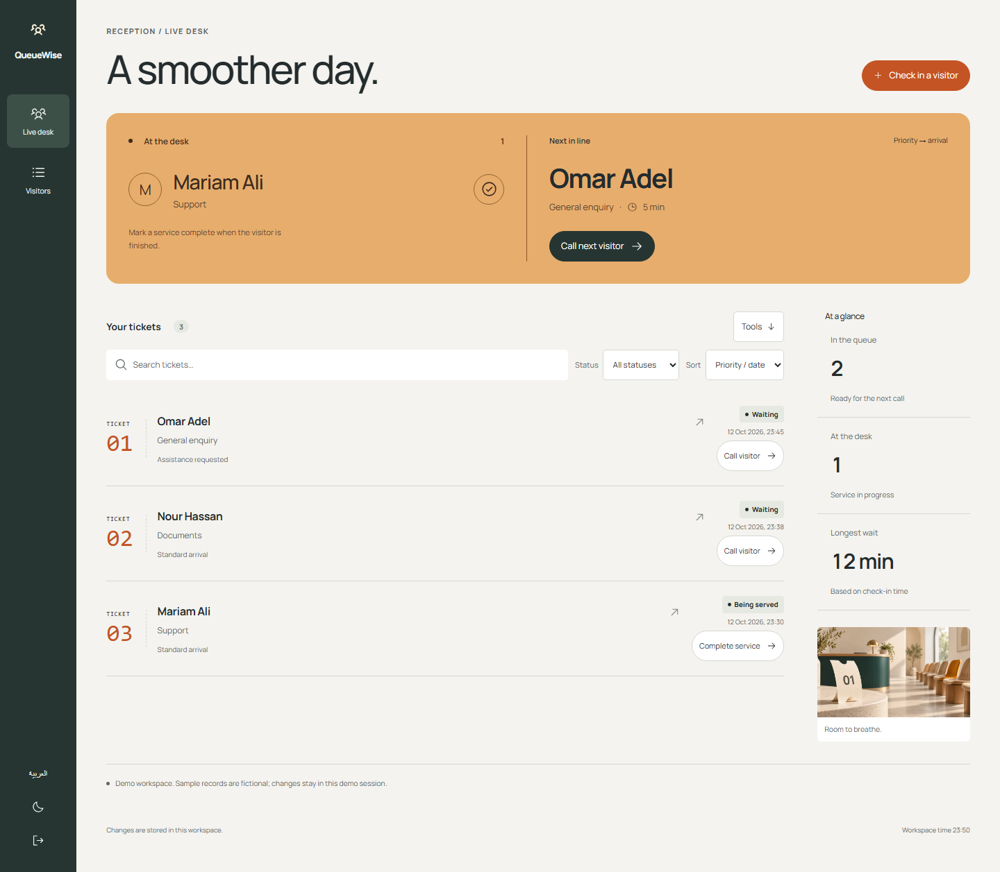
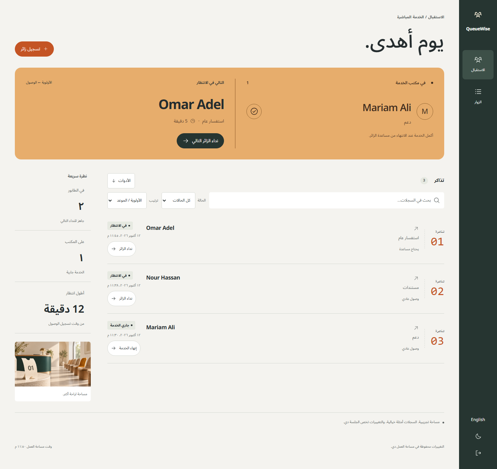
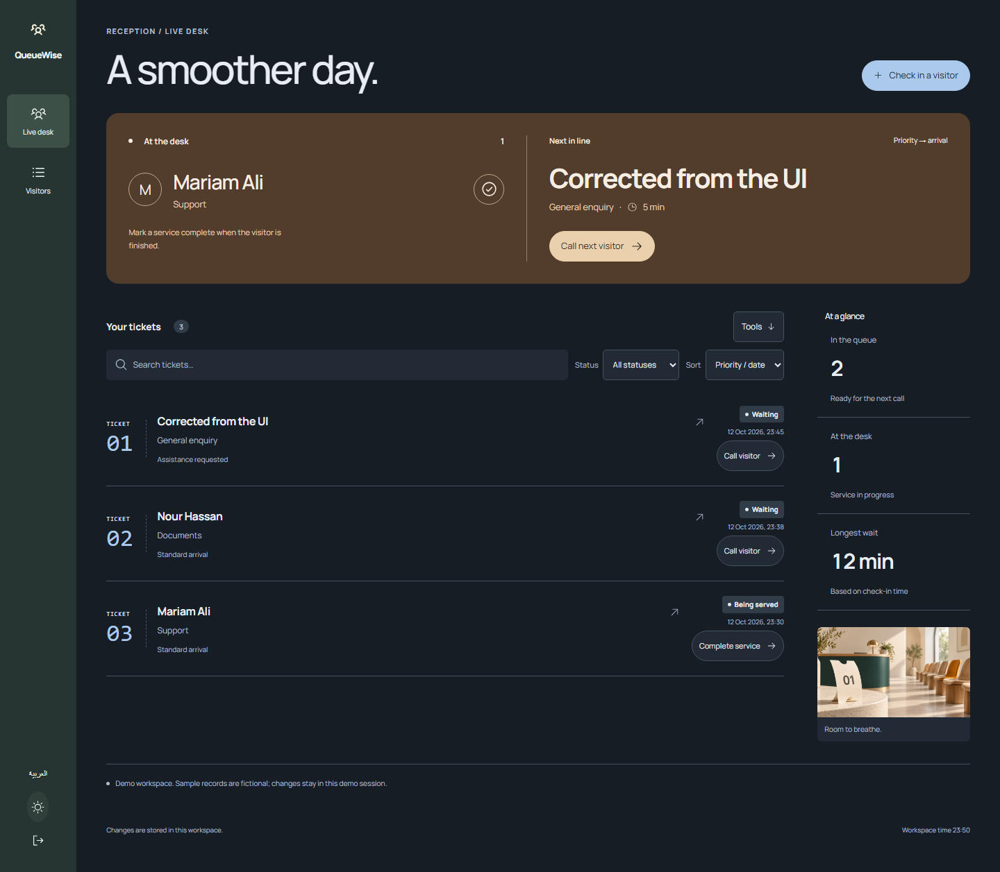

<div align="center">

<h1>QueueWise</h1>
<p><strong>A calmer front desk starts with a clear queue.</strong></p>
<p>For the person keeping a busy reception moving.</p>
</div>

[](https://github.com/Ahmed-Khalil-Mohamed/queuewise/actions/workflows/quality.yml) [](LICENSE) 

[Run locally](#run-locally) · [العربية](#بالعربي) · [Report a bug](https://github.com/Ahmed-Khalil-Mohamed/queuewise/issues/new?template=bug_report.yml) · [Suggest an improvement](https://github.com/Ahmed-Khalil-Mohamed/queuewise/issues/new?template=feature_request.yml)



## From arrival to service

1. Add a visitor, choose a service and whether assistance priority is needed.
2. Call next visitor. Assistance comes first; within that group the earliest arrival wins.
3. Complete the service, or cancel a ticket. Search/filter and inspect the activity log.

## Behind the workflow

- Next-ticket selection runs inside a database transaction, so simultaneous calls cannot select the same waiting ticket.
- Waiting time is calculated from arrival timestamps, not a fake counter.
- The web view polls every 30 seconds; this is eventual refresh, not a WebSocket system.

## More of the interface

<details>
<summary>Arabic workspace / الواجهة العربية</summary>



</details>

<details>
<summary>Dark workspace</summary>



</details>

A narrow evergreen rail, a broad apricot live service stage, a ruled arrival register and a right-hand operational summary. Large human names take priority over metrics.

Screenshots show the actual interface with fictional demonstration records. [Design notes](DESIGN.md) · [Image and icon provenance](ASSETS.md).

## Run locally

Use **Node.js 24 or newer** and npm.

```sh
git clone https://github.com/Ahmed-Khalil-Mohamed/queuewise.git
cd queuewise
npm ci
npm run dev
```

Open **http://localhost:4311/queuewise**. Create an account or explore a separate demo workspace. For a production build, run `npm run build` then `npm start`.

Each checkout owns its dependency lockfile, server, tests and SQLite storage. The browser process uses `data/queuewise.sqlite` and the `queuewise_session` cookie. [Deployment and backups](docs/DEPLOYMENT.md).

## Checks you can run

```sh
npm run format:check
npm run check
npx playwright install chromium
npm run test:e2e
npm audit
```

Lifecycle constraints, assistance/FIFO ordering, empty queue, persistence, and browser check-in-to-completion. Local project results are in [VERIFICATION](docs/VERIFICATION.md).

The [Quality workflow](https://github.com/Ahmed-Khalil-Mohamed/queuewise/actions/workflows/quality.yml) runs on Windows and Linux. The badge above reports the live result. Local evidence, test counts and known validation limits are documented in [VERIFICATION](docs/VERIFICATION.md).

## Current boundaries

No public ticket kiosk, SMS, appointments, multiple service desks, or predicted wait-time model. Coordinators can manually call a particular ticket.

The sample records are fictional. Interview intended users and measure task completion before claiming proven impact. A useful next study is to compare the complete workflow with the person’s current spreadsheet or paper process.

## بالعربي

مكتب خدمة للمشروعات الصغيرة: سجّل الوصول ونادِ على الدور التالي وتابع وقت الانتظار.

بدّل اللغة من زر «العربية». البيانات التجريبية أمثلة وليست سجلات مستخدمين حقيقيين. [دليل التشغيل بالعربي](START-HERE-AR.md).

## Contribute and report

Use the [bug report](https://github.com/Ahmed-Khalil-Mohamed/queuewise/issues/new?template=bug_report.yml) for a reproducible problem, or the [feature request](https://github.com/Ahmed-Khalil-Mohamed/queuewise/issues/new?template=feature_request.yml) to explain a missing workflow. Reports in Arabic and English are welcome. Include the version, expected result and steps; use fictional records and redact personal data.

[Contribution guide](CONTRIBUTING.md) · [Private security reporting](SECURITY.md) · [Changelog](CHANGELOG.md) · [API](docs/API.md) · [Architecture](docs/ARCHITECTURE.md)

## License

[MIT](LICENSE). Third-party packages, fonts and icons retain their own licenses; see [THIRD-PARTY-NOTICES](THIRD-PARTY-NOTICES.md).
